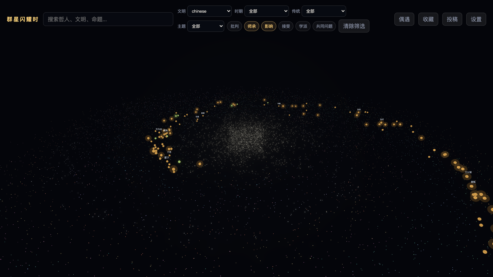
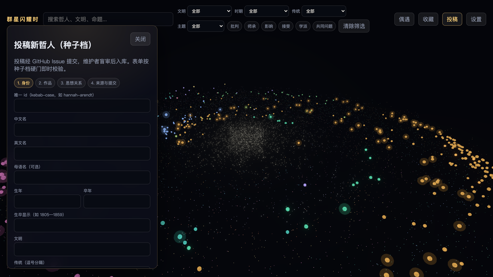

<div align="center">

# When the Stars Shone

**A navigable 3D star map of philosophers — 542 thinkers, 30 civilizations, 1,035 intellectual relationships**

[](https://github.com/gao-cai-sheng/decisive-moments/actions/workflows/validate-data.yml)
[](https://react.dev)
[](https://threejs.org)
[](https://www.typescriptlang.org)
[](https://vite.dev)
[](./LICENSE)
[](./LICENSE-CONTENT.md)

[中文](./README.md) · [Live Demo](https://gao-cai-sheng.github.io/decisive-moments/) · [Quick Start](#-quick-start) · [Editorial Standard](#-where-does-the-content-come-from) · [Contributing](#-contributing)


</div>

---

## What is this

Intellectual history rendered as a starfield you can fly into.

Every philosopher is a star. **Civilization sets its color, era and theme set its position, influence sets its brightness.** Fly close to any one of them and it unfolds into a stellar system — the orbiting planets are the fundamental questions that thinker spent a life on. Open a planet and you get the arguments they offered, the evidence behind each argument, and where in the original text that evidence sits.

This is not a glossary of philosophical terms. It is a **graph of relations**: who criticized whom, who studied under whom, who picked up the same question a thousand years later.

<div align="center">

<br><em>Search → fly into the stellar system → open the full evidence chain of one argument</em>
</div>

## What's in the library

<table>
<tr>
<td align="center"><b>542</b><br><sub>philosophers</sub></td>
<td align="center"><b>30</b><br><sub>civilizations</sub></td>
<td align="center"><b>618</b><br><sub>philosophical problems</sub></td>
<td align="center"><b>1,237</b><br><sub>arguments</sub></td>
</tr>
<tr>
<td align="center"><b>2,474</b><br><sub>evidence entries (with text locators)</sub></td>
<td align="center"><b>1,035</b><br><sub>relationships</sub></td>
<td align="center"><b>1,234</b><br><sub>works</sub></td>
<td align="center"><b>10</b><br><sub>themes</sub></td>
</tr>
</table>

**All traditions are treated equally** — this is not confined to Western academic philosophy. 114 Chinese, 33 Ancient Greek, 33 Islamic, 27 Indian, 24 Jewish, 26 Latin American, 16 Russian, 14 Tibetan Buddhist, 10 Eastern Orthodox, 8 African, 3 Vietnamese, and more. Confucianism, Daoism, Buddhism, the six Indian darśanas, kalam / falsafa / Sufism, Kabbalah, and liberation philosophy all get equal footing.

Philosophers come in two tiers:

| Tier | Count | Contains |
|---|---:|---|
| **standard** | 204 | Full thought system: problems → arguments → evidence → text locators |
| **seed** | 338 | Identity layer: dates, civilization, tradition, themes, one-line summary, source notes |

All 542 carry **source notes** (`sourceNotes`). Nothing goes in unsourced.

## ✨ Features

### 3D navigation with multi-axis filtering

Filter across four axes — civilization, era, tradition, theme — and toggle six kinds of intellectual relationship independently (critique / teacher-student / influence / reception / school / shared problem). All 542 stars are GPU-instanced: 860+ geometries collapsed to 5, roughly 1,600 mesh draws collapsed to 4 instanced draws.



### Stellar system: one philosopher's full structure of thought

Click any star and the camera flies in. The philosopher sits at the center; the orbiting planets are their fundamental questions. The side panel gives dates, a one-line placement, keywords, principal works, and selected arguments.


### Thought infographic: argument → evidence → text locator

Every argument carries evidence cards naming **exactly where** in which work it comes from (e.g. "*Republic* Book VI: the Divided Line passage"), along with its excerpt status. The "extension" section at the bottom threads the argument through intellectual history — who taught, who influenced, who received.


### Collections and notes

Philosophers, arguments, and search questions can all be saved locally, with JSON export / import.


### Also

- **Random encounter** — meet a philosopher at random; the camera takes you there.
- **Bilingual UI** — complete zh / en interface layer; content-layer translation in progress.
- **Full-text search** — philosophers, civilizations, and propositions in one box (fuzzy matching via Fuse.js).
- **Fully static** — no backend, no ops. All data lives as JSON under `public/data`.

## 🔍 Where does the content come from

This is where most of the project's effort went. The 542 entries were not free-form model output. Each one has to clear a **written admission standard** and one round of **human blind review**.

The [admission standard](docs/research/philosopher-definition.md) requires three conditions to hold simultaneously:

1. **A verifiable historical person** — attested, with (approximate) dates. Semi-legendary founders are resolved onto the documented systematizer who actually wrote; dating disputes are flagged in `sourceNotes`.
2. **Attributable written thought** — at least one real work, including teachings compiled posthumously by disciples (Socrates, Confucius, the Buddha, Milarepa), with the compiled or pseudepigraphic nature stated honestly.
3. **Traceable sources** — backed by authoritative reference entries (SEP, IEP, Encyclopaedia of Islam, Encyclopaedia Judaica, Treasury of Lives). Where the record is a mess, the entry is left out rather than guessed at.

Some figures are therefore **deliberately excluded**: mythological and scriptural figures (objects of interpretation, not authors), and patrons or rulers with no attributable writings (Songtsen Gampo, Ashoka, the Medici). They appear as relations and background, never as philosopher nodes. See [`excluded-patrons-rulers.md`](docs/research/excluded-patrons-rulers.md).

**Copyright line**: evidence entries store only summaries and locators, never copyrighted text. Each evidence entry carries an `excerptStatus` field recording its excerpt state.

**Three gates before admission:**

```
research output  →  machine validation        →  human blind review   →  admitted
                    structure / refs /            authenticity /          public/data
                    placeholders                  verifiability
                    tools/validate-*.mjs          review-verdict.md
                    + CI: tsc + test
```

Related: [review checklist](docs/research/review-checklist.md) · [external audit handbook](docs/research/external-audit-handbook.md) · [research pipeline boundary](docs/research/kimi-research-bridge.md)

## 🚀 Quick Start

Requires Node.js 20+.

```bash
git clone https://github.com/gao-cai-sheng/decisive-moments.git
```

```bash
cd decisive-moments && npm install
```

```bash
npm run dev
```

Open http://localhost:5173. The build output is fully static and deploys to any static host:

```bash
npm run build
```

Pushing to `master` publishes to GitHub Pages via [`deploy-pages.yml`](.github/workflows/deploy-pages.yml) (first time, set **Settings → Pages → Source** to *GitHub Actions*). The site is served from the `/decisive-moments/` subpath; that base is handled in `vite.config.ts`. To deploy at a root path (custom domain, other hosts), build with `DEPLOY_BASE=/`.

<details>
<summary><b>All scripts</b></summary>

| Command | Purpose |
|---|---|
| `npm run dev` | Start the dev server |
| `npm run build` | Type-check + production build |
| `npm run preview` | Preview the build output |
| `npm test` | Unit tests (Vitest) |
| `npm run test:smoke` | End-to-end smoke tests (Playwright) |
| `npm run validate:data` | Validate the `public/data` contract |
| `npm run validate:kimi` | Validate a research batch: structure, refs, placeholders |
| `npm run admit:kimi` | Merge a blind-reviewed batch into `public/data` |
| `npm run sync:dist` | Sync data into the build output |
| `npm run shoot:readme` | Regenerate README assets (needs a running dev server; GIF needs ffmpeg) |

</details>

## 🛠 Stack

| Layer | Choice |
|---|---|
| Rendering | Three.js r184 · @react-three/fiber 9 · drei · postprocessing |
| App | React 19 · TypeScript 6 · Zustand 5 |
| Data | Static JSON · Zod 4 runtime validation · idb persistence · Fuse.js search |
| Build | Vite 8 |
| Testing | Vitest 4 (unit) · Playwright (e2e smoke) |
| CI | GitHub Actions: `tsc -b` + `npm test` + data contract validation |

```
src/
├── scene/         3D star map: camera, instanced stars, relationship lines, orbits
├── ui/            Interface: HUD, detail panel, thought infographic, contribution wizard
├── domain/        Domain logic: layout, filters, relationships, contribution validation
├── data/          Data loading, Zod schemas, search index
├── store/         Zustand global state
└── i18n/          zh / en copy and locale switching

public/data/       542 philosopher JSON files + relationships / works / themes / indexes
tools/             Data validation, batch admission, quality audit scripts
docs/              Editorial standards, contribution flow, roadmap
docs/archive/      Content-production archive (not needed to run the app)
```

## 🤝 Contributing

Click "投稿" (Contribute) in the app to open a four-step wizard: **identity → works → intellectual relations → sources and submission**. Every step validates inline against the very same [`src/domain/contribution/validation.ts`](src/domain/contribution/validation.ts) that CI uses — so a green form means a green machine gate.



- External contributions currently accept the **seed tier** (identity layer) only — low barrier, low risk. Promotion to standard tier runs through the internal pipeline.
- Before submitting you confirm a four-point pre-review checklist: really existed / verifiable / relations grounded / no copyrighted text.
- Once everything is green, jump straight to a pre-filled GitHub Issue, or copy / download the JSON and submit by hand.
- If you go the PR route, CI runs type checking, unit tests, and data validation automatically.

Full flow: [`docs/open-contribution-flow.md`](docs/open-contribution-flow.md). For topic ideas, see the [1000-philosopher backlog](docs/philosophers-backlog-1000.md).

## 🗺 Roadmap

- [x] 542 philosophers admitted, 204 with full standard-tier thought systems
- [x] All 542 stars instanced; usable on mobile and low-end GPUs
- [x] Bilingual UI layer with locale switching
- [x] Open contribution: in-app wizard + GitHub Issue / PR flow + CI machine gate
- [x] Live demo auto-deployed to GitHub Pages
- [ ] Content-layer English translation (see [`docs/i18n-content-translation-spec.md`](docs/i18n-content-translation-spec.md))
- [ ] Batch promotion of seed-tier entries to standard tier

Near-term plan: [`docs/next-phase-roadmap-2026-07-22.md`](docs/next-phase-roadmap-2026-07-22.md).

## 📄 License

**Code** — [MIT](./LICENSE).

**Data and documentation** — [CC BY-SA 4.0](./LICENSE-CONTENT.md): the dataset under `public/data/` and the editorial standards under `docs/` may be used and adapted freely, including commercially, with attribution and share-alike.

Evidence entries in the dataset store summaries and locators only, never copyrighted text. The authoritative reference works cited (SEP, IEP, Encyclopaedia of Islam, and others) remain the copyright of their respective owners; this license does not extend to them.
