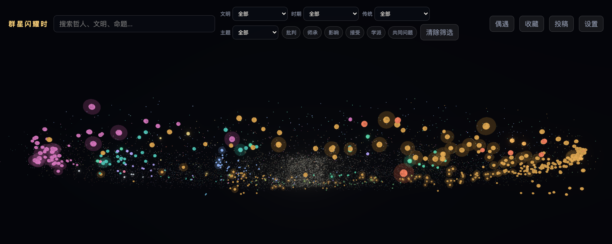
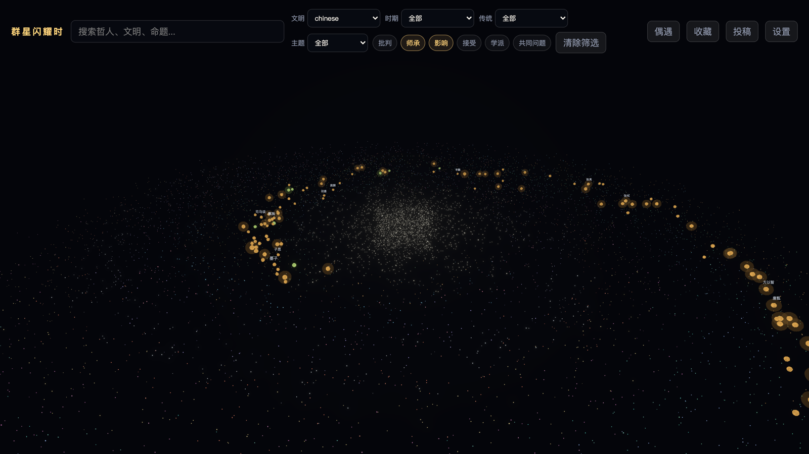
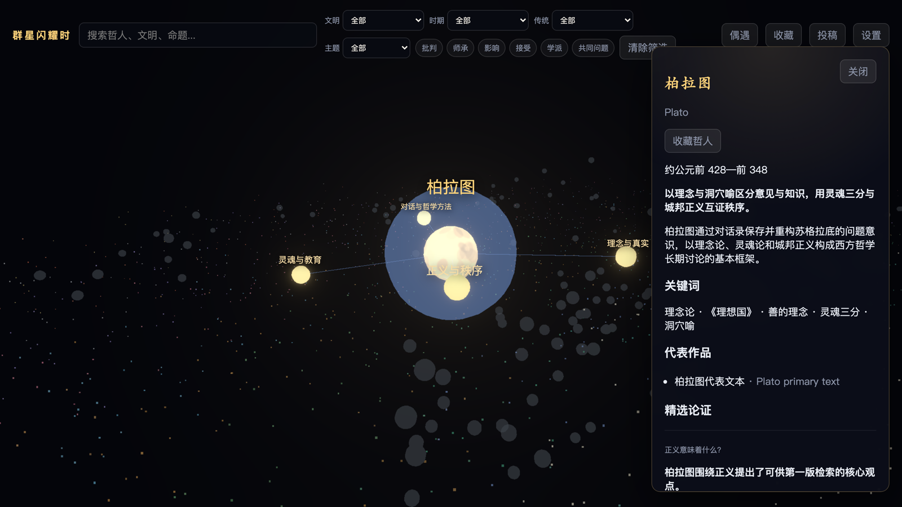
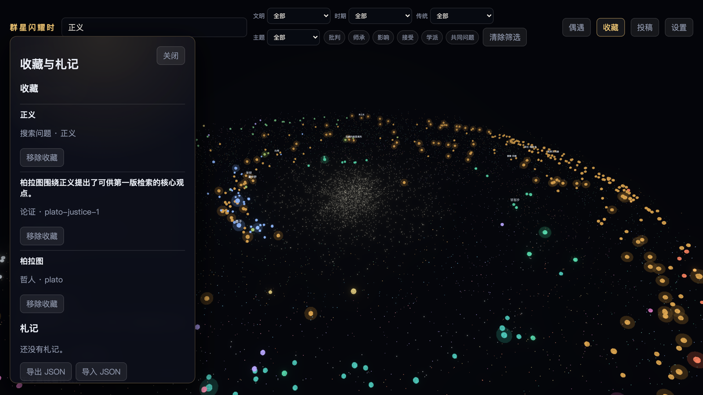
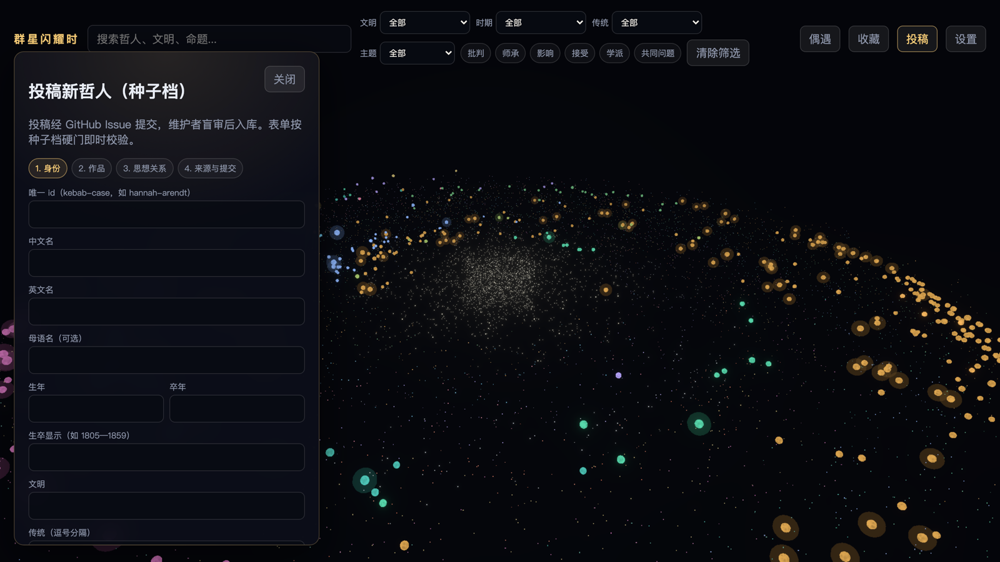

<div align="center">

# 群星闪耀时

**一张可以漫游的三维哲人星图 —— 542 位思想者，30 个文明，1035 条思想关系**

[](https://github.com/gao-cai-sheng/decisive-moments/actions/workflows/validate-data.yml)
[](https://react.dev)
[](https://threejs.org)
[](https://www.typescriptlang.org)
[](https://vite.dev)
[](./LICENSE)
[](./LICENSE-CONTENT.md)

[English](./README.en.md) · [在线体验](https://gao-cai-sheng.github.io/decisive-moments/) · [快速开始](#-快速开始) · [内容标准](#-内容从哪来可信吗) · [参与投稿](#-参与投稿)



</div>

---

## 这是什么

把哲学史做成一片可以飞进去的星空。

每一位哲人是一颗恒星，**文明决定颜色，时代与主题决定它在星图中的位置，影响力决定它的亮度**。飞近任意一颗，它会展开成一个恒星系 —— 环绕的行星是这位哲人毕生追问的根本问题；点开行星，是他为此给出的论证、论证背后的证据，以及每条证据在原始文本中的具体位置。

它不是一个哲学名词词典，而是一张**关系图**：谁批判了谁、谁师承于谁、谁在千年之后接住了同一个问题。

<div align="center">

<br><em>搜索 → 飞入恒星系 → 展开一条论证的完整证据链</em>
</div>

## 库里有什么

<table>
<tr>
<td align="center"><b>542</b><br><sub>位哲人</sub></td>
<td align="center"><b>30</b><br><sub>个文明</sub></td>
<td align="center"><b>618</b><br><sub>个哲学问题</sub></td>
<td align="center"><b>1,237</b><br><sub>条论证</sub></td>
</tr>
<tr>
<td align="center"><b>2,474</b><br><sub>条证据（带原文定位）</sub></td>
<td align="center"><b>1,035</b><br><sub>条思想关系</sub></td>
<td align="center"><b>1,234</b><br><sub>部作品</sub></td>
<td align="center"><b>10</b><br><sub>大主题</sub></td>
</tr>
</table>

**跨文明一视同仁**，不限于西方学院哲学。中国 114 位、古希腊 33 位、伊斯兰 33 位、印度 27 位、犹太 24 位、拉美 26 位、俄罗斯 16 位、藏传 14 位、东正教 10 位、非洲 8 位、越南 3 位……儒道释、印度六派、kalam / falsafa / 苏非、卡巴拉、解放哲学同等对待。

哲人分两档：

| 档位 | 数量 | 含有 |
|---|---:|---|
| **standard**（标准档） | 204 | 完整思想体系：根本问题 → 论证 → 证据 → 原文定位 |
| **seed**（种子档） | 338 | 身份层：生卒、文明、传统、主题、一句话定位、来源注记 |

全部 542 位**都带来源注记**（`sourceNotes`），没有裸奔的条目。

## ✨ 主要功能

### 三维星图漫游与多维筛选

按文明、时代、传统、主题四个维度交叉筛选，六类思想关系（批判 / 师承 / 影响 / 接受 / 学派 / 共同问题）可独立开关。542 颗星全部走 GPU 实例化渲染 —— 860+ 份几何体压到 5 份，约 1600 次 mesh 绘制压到 4 次 instanced draw。



### 恒星系：一位哲人的完整思想结构

点开任意一颗星，相机飞入。中心是哲人本人，环绕的行星是他毕生追问的根本问题；右栏给出生卒、一句话定位、关键词、代表作与精选论证。



### 思想信息图：论证 → 证据 → 原文定位

每条论证都配有证据卡片，标注它出自哪部作品的**哪一处**（如「《理想国》第六卷：线段比喻段落」），并注明摘引状态。底部的「外延」串起这条论证在思想史中的上下游 —— 谁师承、谁影响、谁接受。


### 收藏与札记

哲人、论证、搜索问题都可以收藏，本地留存，支持导出 / 导入 JSON。



### 其他

- **偶遇** —— 随机认识一位哲人，相机直接带你飞过去。
- **中英双语界面** —— UI 层完整 zh / en，内容层英译进行中。
- **全文搜索** —— 哲人、文明、命题一并检索（Fuse.js 模糊匹配）。
- **纯静态** —— 零后端、零运维，数据全部是 `public/data` 下的 JSON。

## 🔍 内容从哪来，可信吗

这是这个项目投入最大的部分。542 条目不是让模型自由发挥写出来的，每一条都要过一道**成文的收录判据**和一次**人工盲审**。

**收录判据**（完整版见 [`docs/research/philosopher-definition.md`](docs/research/philosopher-definition.md)）要求三条硬核同时成立：

1. **真人可考** —— 历史确证、有（约）生卒。半传说的奠基者落到可考的系统家身上；断代争议在 `sourceNotes` 里标注。
2. **有可归属的思想著述** —— 至少一部真实作品，包括身后由弟子结集的教法（苏格拉底、孔子、佛陀、密勒日巴皆此类），诚实标注结集或托名性质。
3. **来源可追溯** —— SEP / IEP / Encyclopaedia of Islam / Encyclopaedia Judaica / Treasury of Lives 等权威条目支撑；资料混乱者宁缺毋滥。

因此有一批人物被**明确排除**：神话与经文人物（是被诠释的对象，不是作者）、无可考著述的护法君主与赞助者（松赞干布、阿育王、美第奇一类）——他们只作为关系与背景出现，不占哲人节点。见 [`excluded-patrons-rulers.md`](docs/research/excluded-patrons-rulers.md)。

**版权红线**：证据一律只存**摘要与定位**，不存版权正文。数据里每条证据都带 `excerptStatus` 字段标明摘引状态。

**入库要过三道门**：

```
研究产出  →  机器校验              →  人工盲审          →  入库
             结构 / 引用 / 占位          真实性 / 可核实       public/data
             tools/validate-*.mjs       review-verdict.md
             + CI: tsc + test
```

相关规范：[审核清单](docs/research/review-checklist.md) · [外部审计手册](docs/research/external-audit-handbook.md) · [研究管线边界](docs/research/kimi-research-bridge.md)

## 🚀 快速开始

需要 Node.js 20+。

```bash
git clone https://github.com/gao-cai-sheng/decisive-moments.git
```

```bash
cd decisive-moments && npm install
```

```bash
npm run dev
```

打开 http://localhost:5173 即可。构建产物是纯静态文件，可直接部署到任何静态托管：

```bash
npm run build
```

推送到 `master` 会由 [`deploy-pages.yml`](.github/workflows/deploy-pages.yml) 自动发布到 GitHub Pages（首次使用需在仓库 **Settings → Pages → Source** 选 *GitHub Actions*）。站点挂在 `/decisive-moments/` 子路径下，这个 base 由 `vite.config.ts` 处理；若要部署到根路径（自定义域名等），构建时设 `DEPLOY_BASE=/`。

<details>
<summary><b>全部脚本</b></summary>

| 命令 | 作用 |
|---|---|
| `npm run dev` | 启动开发服务器 |
| `npm run build` | 类型检查 + 生产构建 |
| `npm run preview` | 预览构建产物 |
| `npm test` | 单元测试（Vitest） |
| `npm run test:smoke` | 端到端冒烟测试（Playwright） |
| `npm run validate:data` | 校验 `public/data` 的数据契约 |
| `npm run validate:kimi` | 校验研究批次的结构、引用与占位 |
| `npm run admit:kimi` | 盲审通过后把批次并入 `public/data` |
| `npm run sync:dist` | 同步构建产物中的数据 |
| `npm run shoot:readme` | 重新生成 README 素材（需先起 dev server；GIF 需 ffmpeg） |

</details>

## 🛠 技术栈

| 层 | 选型 |
|---|---|
| 渲染 | Three.js r184 · @react-three/fiber 9 · drei · postprocessing |
| 应用 | React 19 · TypeScript 6 · Zustand 5 |
| 数据 | 静态 JSON · Zod 4 运行时校验 · idb 本地持久化 · Fuse.js 检索 |
| 构建 | Vite 8 |
| 测试 | Vitest 4（单元） · Playwright（端到端冒烟） |
| CI | GitHub Actions：`tsc -b` + `npm test` + 数据契约校验 |

```
src/
├── scene/         三维星图：相机、恒星实例化、关系连线、轨道
├── ui/            界面层：HUD、详情面板、思想信息图、投稿向导、收藏
├── domain/        领域逻辑：星图布局、筛选、关系、投稿校验、收藏
├── data/          数据加载与 Zod schema、搜索索引
├── store/         Zustand 全局状态
└── i18n/          中英文案与 locale 切换

public/data/       542 份哲人 JSON + 关系 / 作品 / 主题 / 索引
tools/             数据校验、批次入库、质量审计脚本
docs/              内容标准、投稿流程、路线图
docs/archive/      内容生产过程存档（不影响使用）
```

## 🤝 参与投稿

站内点「投稿」即可打开四步向导：**身份 → 作品 → 思想关系 → 来源与提交**。每一步内联校验，规则与 CI 共用同一份 [`src/domain/contribution/validation.ts`](src/domain/contribution/validation.ts)，所以表单通过 = 机器门通过。



- 外部投稿目前只开 **seed 档**（身份层），门槛低、风险小；standard 档升格走内部管线。
- 提交前需勾选四项预盲审清单：真实存在 / 可核对 / 关系有据 / 无版权正文。
- 全绿后一键跳转 GitHub Issue（预填 body），或复制 / 下载 JSON 手动提交。
- 走 PR 的话，CI 会自动跑类型检查、单测与数据校验。

完整流程见 [`docs/open-contribution-flow.md`](docs/open-contribution-flow.md)。选题可以参考 [1000 人待收录池](docs/philosophers-backlog-1000.md)。

## 🗺 路线图

- [x] 542 位哲人入库，204 位完成标准档思想体系
- [x] 542 颗星实例化渲染，移动端与低端 GPU 可用
- [x] UI 层中英双语 + locale 切换
- [x] 开放投稿：站内向导 + GitHub Issue / PR 流 + CI 机器门
- [x] 在线 Demo：GitHub Pages 自动部署
- [ ] 内容层英译（见 [`docs/i18n-content-translation-spec.md`](docs/i18n-content-translation-spec.md)）
- [ ] seed 档批量升格为 standard 档

近期计划见 [`docs/next-phase-roadmap-2026-07-22.md`](docs/next-phase-roadmap-2026-07-22.md)。

## 📄 许可

**代码** —— [MIT](./LICENSE)。

**数据与文档** —— [CC BY-SA 4.0](./LICENSE-CONTENT.md)：`public/data/` 下的哲人数据集与 `docs/` 下的编辑标准可自由使用与演绎（含商用），只需署名并以相同协议共享。

数据中的证据条目只存摘要与定位，不含版权正文；引用的权威工具书（SEP、IEP、Encyclopaedia of Islam 等）版权归各自所有者，本项目的授权不及于它们。
